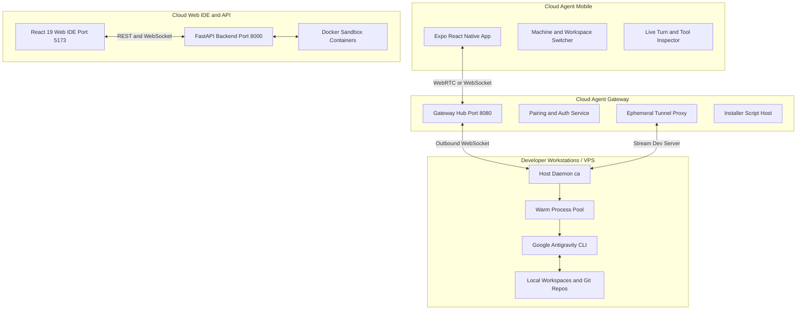

# Cloud Agent ☁️🤖

<div align="center">


**Autonomous AI Coding Agent Platform Across Mobile, Desktop, and Cloud**

Drive full autonomous software development on your local workstations, cloud VPS servers, and Docker containers directly from your mobile phone or web browser.

[](https://nodejs.org/)
[](https://pnpm.io/)
[](https://reactnative.dev/)
[](https://fastapi.tiangolo.com/)
[](https://react.dev/)
[](https://www.typescriptlang.org/)
[](https://turbo.build/)
[](LICENSE)

</div>

---

## ⚡ Quick Start: Install Host Daemon (`ca`)

Connect your laptop, development desktop, or cloud VPS to Cloud Agent in under 60 seconds with our one-line installer:

### 🐧 Linux & 🍎 macOS (Bash / Zsh)
```bash
curl -fsSL https://gateway.cloud-agent.abhishekkkk.in/install.sh | bash
```

### 🪟 Windows (PowerShell)
```powershell
irm https://gateway.cloud-agent.abhishekkkk.in/install.ps1 | iex
```

### 📲 Instant Terminal Pairing
After installation, run:
```bash
ca pair
```
Scan the terminal QR code from your **Cloud Agent Mobile** app or enter the 6-character code. Your machine is immediately paired and ready to receive autonomous coding tasks!

> 📖 **Full Daemon Documentation**: See [apps/daemon/README.md](apps/daemon/README.md) for detailed commands (`ca workspace`, `ca service`, `ca logs`, `ca expose`, `ca doctor`).

---

## 🌟 Key Capabilities

### 📱 Cloud Agent Mobile (iOS & Android)
- **Fluid Modern Dark UI**: Crafted with a deep canvas (`#0d1117`), crisp slate cards (`#161b22`), and Pacific Azure accents (`#0077b6`).
- **Swipeable Sidebar Drawer**: Effortlessly switch between connected host machines, active workspaces, and previous chat sessions with left-edge gestures.
- **Live Tool Execution Trays**: Inspect real-time agent bash commands, file edits, git operations, and diagnostics with line-by-line syntax highlighting.
- **Diff Reviewer**: Review agent code modifications before approving git commits and pushes.
- **Zero-Mock Dynamic Data**: True real-time streaming directly from your host machines and gateway.

### 💻 Host Daemon (`apps/daemon` / `ca`)
- **Zero-DB & Outbound-Only**: Runs entirely database-free. Connects outbound to the Gateway via WebSocket (`/daemon/ws`) with zero required inbound ports or firewall configurations.
- **Warm Persistent Process Pool**: Keeps worker processes alive with open `stdin` pipes to eliminate turn latency and redundant disk re-reads.
- **Headless Execution**: Automated permission bypass flags ensure coding agents never stall waiting for interactive TTY confirmations.
- **Dev Server Tunneling (`ca expose <port>`)**: Instantly preview local dev servers on mobile via ephemeral gateway tunnels.
- **Background Service**: Self-installs as a native system service (`systemd`, `launchd`, Windows scheduled task).

### 🌐 Gateway Hub (`apps/gateway`)
- **Central Multiplexer**: High-speed Node.js + Express + WebSocket hub handling device pairing, WebRTC signaling, streaming RPCs, and script hosting.
- **Ephemeral HTTP Proxy**: Reverse proxies dev server preview tunnels from daemons to mobile browsers.
- **Self-Hosted Installer Endpoints**: Hosts `/install.sh` and `/install.ps1` for instant zero-dependency deployment.

### 🖥️ Cloud Web IDE & Sandboxes (`apps/web` + `apps/api`)
- **Full Monaco Web Editor**: Syntax highlighting, real-time file tree navigation, and interactive xterm.js terminal.
- **Docker Sandboxing**: Spin up ephemeral, isolated containers with CPU and memory quotas for untrusted builds.
- **Subdomain Routing**: Automatic port forwarding routing `<workspace-id>.lvh.me` to active development containers.

---

## 🏗️ System Architecture



---

## 📁 Repository Structure

```
cloud-agent/
├── apps/
│   ├── daemon/               # Zero-DB pluggable host daemon CLI ('ca')
│   │   ├── README.md         # Dedicated Daemon guide & command manual
│   │   ├── CONTEXT.md        # Daemon technical architecture & invariants
│   │   └── AGENTS.md         # Daemon developer & subagent operational rules
│   │
│   ├── mobile/               # React Native / Expo iOS & Android client
│   │   ├── CONTEXT.md        # Mobile navigation, store, and WebRTC architecture
│   │   └── AGENTS.md         # Mobile UI styling guidelines & invariants
│   │
│   ├── gateway/              # WebSocket hub, pairing manager & tunnel proxy
│   │   ├── CONTEXT.md        # Gateway RPC protocol & routing architecture
│   │   └── AGENTS.md         # Gateway developer guidelines
│   │
│   ├── desktop/              # Electron desktop application shell
│   │   ├── CONTEXT.md        # Desktop architecture documentation
│   │   └── AGENTS.md         # Desktop developer guidelines
│   │
│   ├── web/                  # React 19 + Monaco + Vite browser workspace
│   │   ├── CONTEXT.md        # Web IDE architecture & state flows
│   │   └── AGENTS.md         # Web IDE design & coding rules
│   │
│   └── api/                  # Python FastAPI backend with Docker sandboxing
│       ├── CONTEXT.md        # API routes, Docker sandbox & MongoDB reference
│       └── AGENTS.md         # Python backend conventions & invariants
│
├── packages/
│   ├── cli/antigravity/      # Headless adapter for Google Antigravity ('agy')
│   │   ├── CONTEXT.md        # Antigravity CLI adapter architecture
│   │   └── AGENTS.md         # CLI adapter guidelines
│   │
│   ├── cli-interface/        # Common interfaces & contract for agent CLI engines
│   │   ├── CONTEXT.md        # CLI interface abstractions
│   │   └── AGENTS.md         # CLI interface guidelines
│   │
│   └── shared/               # Shared TypeScript types, schemas & Zod validators
│
├── scripts/
│   ├── install.sh            # Global installer script for Linux & macOS
│   └── install.ps1           # Global installer script for Windows PowerShell
│
├── AGENTS.md                 # Monorepo-wide Golden Rules & standards
├── turbo.json                # Turborepo pipeline configuration
├── pnpm-workspace.yaml       # Monorepo workspace configuration
└── package.json              # Monorepo scripts & dependencies
```

---

## 📖 Sub-Application Documentation

Each component within the Cloud Agent monorepo maintains dedicated architecture documentation (`CONTEXT.md`) and agent operational guidelines (`AGENTS.md`):

| App / Package | Purpose | Guide | Architecture | Agent Rules |
|---|---|---|---|---|
| **Daemon** (`apps/daemon`) | Host machine CLI (`ca`) | [README.md](apps/daemon/README.md) | [CONTEXT.md](apps/daemon/CONTEXT.md) | [AGENTS.md](apps/daemon/AGENTS.md) |
| **Mobile** (`apps/mobile`) | Expo iOS/Android app | [README.md](apps/mobile/README.md) | [CONTEXT.md](apps/mobile/CONTEXT.md) | [AGENTS.md](apps/mobile/AGENTS.md) |
| **Gateway** (`apps/gateway`) | Central signaling hub | [README.md](apps/gateway/README.md) | [CONTEXT.md](apps/gateway/CONTEXT.md) | [AGENTS.md](apps/gateway/AGENTS.md) |
| **Desktop** (`apps/desktop`) | Electron client | [README.md](apps/desktop/README.md) | [CONTEXT.md](apps/desktop/CONTEXT.md) | [AGENTS.md](apps/desktop/AGENTS.md) |
| **Web IDE** (`apps/web`) | Browser code workspace | [README.md](apps/web/README.md) | [CONTEXT.md](apps/web/CONTEXT.md) | [AGENTS.md](apps/web/AGENTS.md) |
| **API** (`apps/api`) | Docker backend | [README.md](apps/api/README.md) | [CONTEXT.md](apps/api/CONTEXT.md) | [AGENTS.md](apps/api/AGENTS.md) |
| **CLI Antigravity** (`packages/cli/antigravity`) | Google AGY adapter | — | [CONTEXT.md](packages/cli/antigravity/CONTEXT.md) | [AGENTS.md](packages/cli/antigravity/AGENTS.md) |
| **CLI Interface** (`packages/cli-interface`) | Abstract CLI types | — | [CONTEXT.md](packages/cli-interface/CONTEXT.md) | [AGENTS.md](packages/cli-interface/AGENTS.md) |

---

## 🛠️ Monorepo Operations

### Prerequisites
- **Node.js**: `20.x` or higher
- **pnpm**: `9.x` or higher (`npm install -g pnpm`)
- **Python**: `3.11`+ (for `apps/api`)

### Installation & Builds
```bash
# Clone the repository
git clone https://github.com/Abhishekkkk-15/cloud-agent.git
cd cloud-agent

# Install dependencies across all packages
pnpm install

# Build all apps & packages
pnpm build
```

### Running Targeted Development Servers
```bash
# Gateway Hub (Port 8080)
pnpm --filter @cloud-agent/gateway dev

# Daemon (Connect to local or remote gateway)
pnpm --filter @cloud-agent/daemon dev start

# Mobile App (Expo Metro bundler)
pnpm --filter @cloud-agent/mobile dev

# Web IDE (Vite Port 5173)
pnpm --filter @cloud-agent/web dev
```

### Typechecking
```bash
# Monorepo typecheck
pnpm typecheck

# Individual package typecheck
pnpm --filter @cloud-agent/daemon typecheck
pnpm --filter @cloud-agent/gateway typecheck
pnpm --filter @cloud-agent/mobile typecheck
```

---

## 📜 Golden Rules & Invariants

All contributors and AI agents must abide by the core platform invariants detailed in [AGENTS.md](AGENTS.md):
1. **Explicit Git Commits Only**: Never run `git commit` or `git push` autonomously unless explicitly instructed in the user's prompt.
2. **Zero-DB Daemon Invariant**: `apps/daemon` must remain completely database-free. Transcripts are streamed line-by-line from native disk NDJSON files.
3. **Warm Persistent Process Pool**: Workers maintain an open `stdin` pipe to prevent multi-second cold-start latency between chat turns.
4. **Headless Execution**: CLI adapters run non-interactively with `--dangerously-skip-permissions`.
5. **Zero-Mock Dynamic UI**: Mobile and Web UIs strictly render real-time telemetry and streams from connected daemons.

---

## 📄 License

This project is licensed under the [MIT License](LICENSE).
